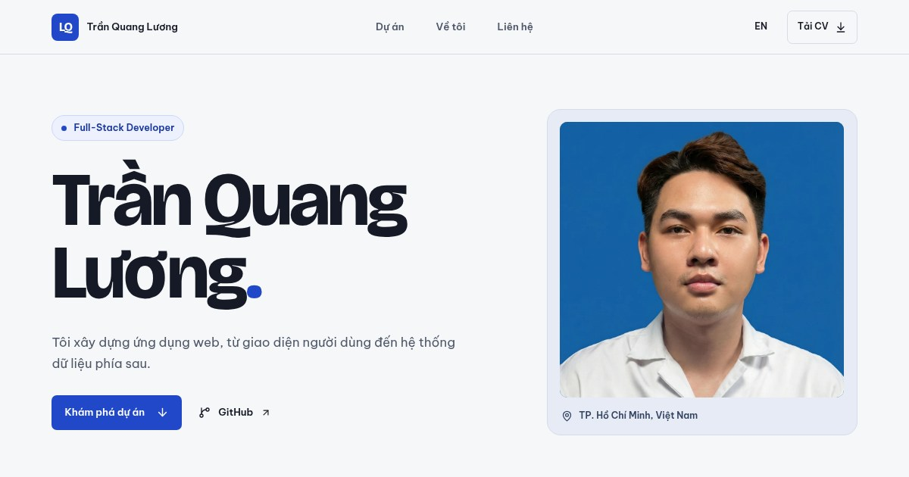

# Trần Quang Lương · Portfolio

Portfolio của Trần Quang Lương, Full-Stack Developer tại TP. Hồ Chí Minh. Mỗi case study trình bày bài toán, cách triển khai, kiến trúc và liên kết đến mã nguồn khi có.

[**Xem portfolio**](https://lunuportfolio.vercel.app/) · [GitHub Pages](https://luongnuong131.github.io/AboutMe/) · [Tải CV](https://lunuportfolio.vercel.app/cv-tran-quang-luong.pdf)

[](https://lunuportfolio.vercel.app/)

## Dự án tiêu biểu

| Dự án | Nội dung | Liên kết |
| --- | --- | --- |
| **AF_Booking** | Điều phối booking, bàn giao, lịch sử thay đổi và kiểm tra xung đột khi lưu. | [Case study](https://lunuportfolio.vercel.app/project/af-booking) · [GitHub](https://github.com/LuongNuong131/AF_Booking) |
| **FCDBB** | Lịch sân, điểm danh GPS, đội hình A/B, bảng xếp hạng và quỹ đội bóng. | [Case study](https://lunuportfolio.vercel.app/project/fcdbb) · [GitHub](https://github.com/LuongNuong131/LuNu_FCDBB) |
| **LuNu Music** | Thư viện nghe nhạc, hàng đợi, lyrics, playlist và phòng xem video. | [Case study](https://lunuportfolio.vercel.app/project/lunu-music) · [GitHub](https://github.com/LuongNuong131/LuNu_Music) |

Portfolio dùng Vue 3, Vue Router và Vite, có giao diện tiếng Việt và tiếng Anh. Bản build tạo HTML riêng cho từng đường dẫn dự án để hỗ trợ tải lại trang và hiển thị thông tin khi chia sẻ liên kết.

## Chạy local

Cần Git, Node.js 24 và npm.

```bash
git clone https://github.com/LuongNuong131/AboutMe.git
cd AboutMe
npm ci
npm run dev
```

Mở [http://localhost:5173](http://localhost:5173). Để kiểm tra bản production trên máy:

```bash
npm run build
npm run preview
```

## Cập nhật nội dung

| Nội dung | Vị trí |
| --- | --- |
| Dự án, bản tiếng Việt và tiếng Anh, công nghệ và liên kết | [src/data/projects.js](src/data/projects.js) |
| Tên hiển thị, email, GitHub và domain chính | [src/data/site.js](src/data/site.js) |
| Giới thiệu, kỹ năng và liên hệ | [src/views/HomeView.vue](src/views/HomeView.vue) |
| Ảnh đại diện | [src/assets/AnhThe.webp](src/assets/AnhThe.webp) |
| CV | [public/cv-tran-quang-luong.pdf](public/cv-tran-quang-luong.pdf) |
| Ảnh dự án | [public/projects](public/projects/) |

Để thay ảnh đại diện, thay `src/assets/AnhThe.webp` bằng ảnh WebP mới. Nếu đổi tỷ lệ ảnh, cập nhật `width` và `height` của ảnh trong `HomeView.vue`. Ảnh AF_Booking và FCDBB lấy từ tài liệu dự án. Ảnh LuNu Music chụp từ màn hình đăng nhập công khai.

## Production

- **Vercel** chạy `npm ci` và `npm run build` từ nhánh `master`, rồi phục vụ thư mục `dist/`. [Cấu hình Vercel](vercel.json)
- **GitHub Pages** build cùng mã nguồn với base path `/AboutMe/` và triển khai bằng GitHub Actions. [Workflow triển khai](.github/workflows/pages.yml)
